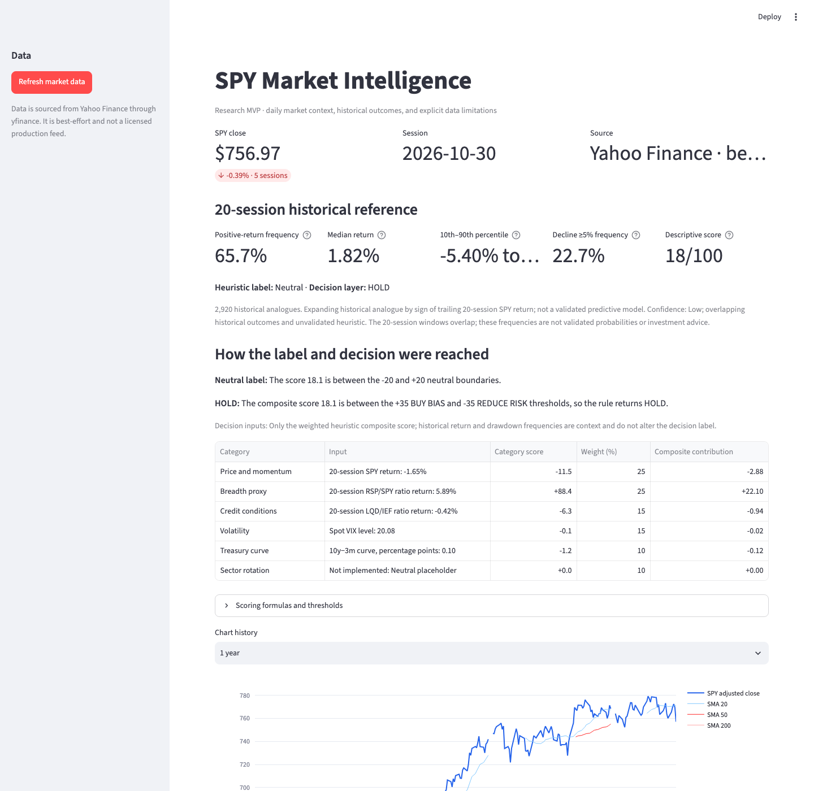
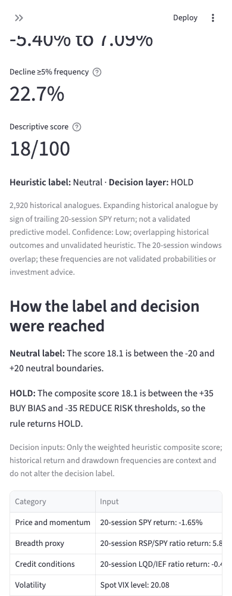

# SPY Market Intelligence MVP

A transparent Streamlit application for daily SPY monitoring. It includes price and momentum indicators, VIX, credit and breadth proxies, Treasury-yield proxies, a heuristic score, historical 20-session analysis, a basic walk-forward baseline check, and forecast history stored locally in SQLite.

## Disclaimer

This project is for educational and informational purposes only. It is not investment, financial, legal, or tax advice, and it is not a recommendation, offer, or solicitation to buy or sell any security. The dashboard does not consider any user's objectives, financial situation, or risk tolerance. Consult a qualified financial professional before making investment decisions.

Market data may be incomplete, delayed, revised, or inaccurate. Forecasts, scores, classifications, historical frequencies, and backtests are experimental, heuristic, and unvalidated; they are not guarantees of future results. Investing involves risk, including the possible loss of principal. Independently verify data and calculations before relying on them.

The project code is distributed under the [MIT License](LICENSE). That license does not grant rights to third-party market data or change the data providers' terms of use.

## Quick start

```bash
uv sync --extra test
uv run python -m src.pipeline
uv run streamlit run app.py
```

Open the local URL printed by Streamlit. The first pipeline run downloads market history, stores it in `data/market_intelligence.sqlite3`, and saves a forecast. Later, use **Refresh market data** in the sidebar to update it.

## Dashboard screenshots

Captured with Yahoo Finance data on 2026-10-30. These are historical snapshots and may no longer reflect current market conditions.

**Desktop**



**Mobile**



## Scheduled updates

Run the timezone-aware weekday scheduler at 18:30 America/New_York:

```bash
uv run python -m src.scheduler
```

Keep the process running under a process manager on the machine that owns the SQLite database. The pipeline can also be run on demand with `uv run python -m src.pipeline`.

## MVP scope and limitations

- Yahoo Finance through `yfinance` is the default development source. It is best-effort, may be delayed or revised, and is not a licensed production feed. Confirm provider terms before redistribution or production use.
- Adjusted daily prices are used for return calculations. Yahoo Finance `^TNX` and `^IRX` are yield-index proxies, not a point-in-time macroeconomic database; the 3-month / 10-year curve is illustrative.
- SQLite is used for a zero-configuration MVP. The production specification calls for PostgreSQL; migrate before multi-user or hosted deployment.
- RSP/SPY is a breadth proxy, not constituent-level breadth. Point-in-time constituent membership, sector rotation, options, a macro release calendar, and licensed credit-spread data are not included.
- The score and BUY BIAS / HOLD / REDUCE RISK labels are descriptive heuristics, not validated trading recommendations. Neutral placeholder categories are disclosed in the decision breakdown.
- Historical 20-session references group prior matured observations by the sign of the trailing 20-session SPY return. Outcomes overlap, so observations are not independent; this is not a validated analogue model.
- The walk-forward Brier check is a simple expanding unconditional baseline sampled every 20 sessions with a horizon purge. It does not establish forecast skill or strategy profitability.
- Forecasts are saved once per session date and are immutable. Production-grade retries, authentication, alerting, and monitoring are not yet implemented.

## Tests

```bash
uv run pytest
```
